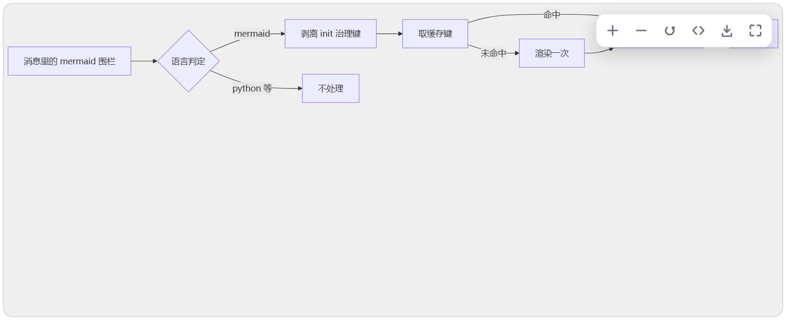
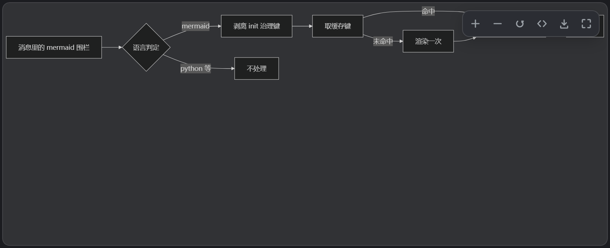
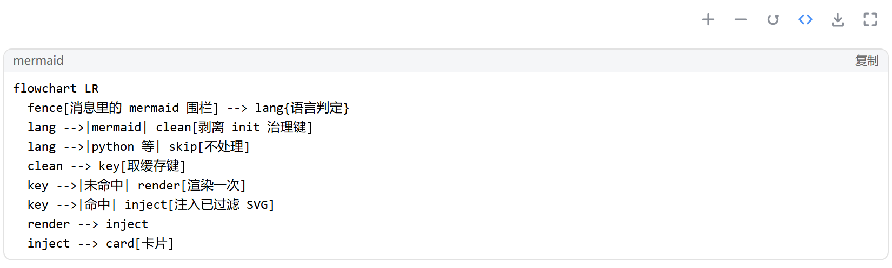
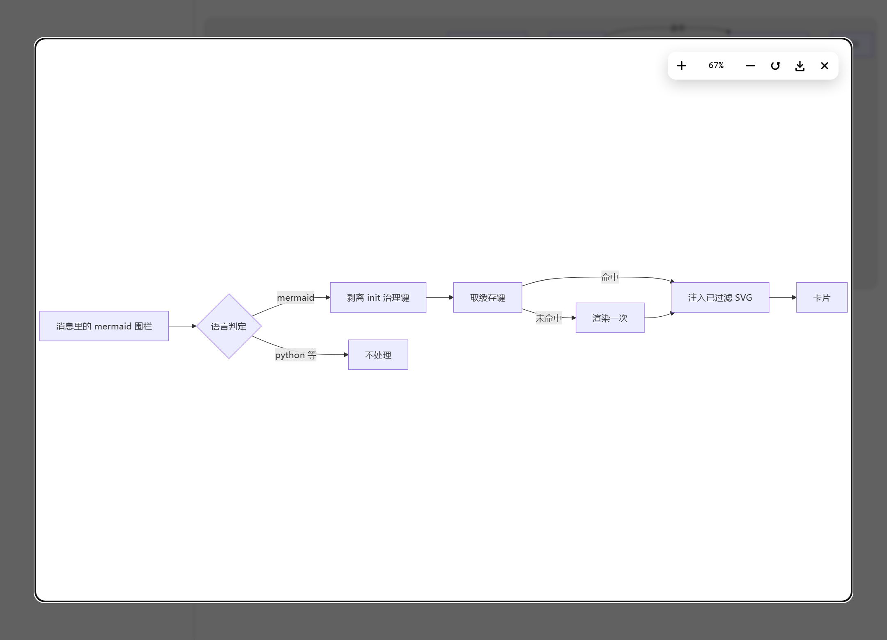

# dsh-mermaid-studio

A DeepSeek Harness plugin that renders mermaid fences in the conversation as diagrams. Zoom, go fullscreen, export SVG. Renders stay on your machine, so returning to the same diagram does not redraw it.

English | [中文](README.md)



## What it does

- **Fence detection**: claims `mermaid` and `mmd`. The host labels those fences with its generic "code block" text and the plugin still recognises them; fences with a real language name (`python`, `ts`) are never claimed.
- **Rendering**: mermaid 11.17.2 is bundled, no network. Renders run one at a time with a 15 s timeout and a breaker after two consecutive timeouts, so one bad diagram cannot hold up the rest.
- **Cache**: memory plus IndexedDB. A hit is injected directly with no flash, and survives reloads and restarts.
- **Gestures**: Ctrl/⌘ + wheel zooms around the pointer, drag pans, double-click toggles between fit and 1:1.
- **Controls**: no persistent toolbar. Hovering the diagram floats six buttons at the top-right (zoom in, zoom out, reset, source, export, fullscreen); they hide when the pointer leaves.
- **Fullscreen**: a CSS overlay, not the system F11. Esc closes it and focus returns to the trigger; the zoom percentage is editable.
- **Export**: SVG only, serialised from the filtered tree.
- **Theme**: always follows the host's light/dark mode, with separate cache entries for each.

## Screenshots

<table>
  <tr>
    <td align="center" width="50%"><br><sub>Light: the fence becomes a card; hovering floats the controls</sub></td>
    <td align="center" width="50%"><br><sub>Dark: follows the host, both themes cached separately</sub></td>
  </tr>
  <tr>
    <td align="center"><br><sub><code>&lt;/&gt;</code> shows the source; the control row stays above the code block</sub></td>
    <td align="center"><br><sub>Fullscreen: the zoom percentage is editable</sub></td>
  </tr>
</table>

## How it works

The plugin ships as a two-half bundle: the host half only carries configuration, and all UI and rendering live in the browser half. One fence goes through six steps:

1. **Find the fence**: scan the host's `div.md-code-block` elements and decide the language from three signals: banner text, a `language-*` class, and a strict first-line keyword. The banner shows a localised generic label for mermaid, so the first-line rule is the fallback. A hit inserts a card before the code block, and the block itself is never touched.
2. **Strip governance keys**: `%%{init: …}%%` and frontmatter keys such as `securityLevel`, `htmlLabels`, `fontFamily` and `themeVariables` are removed, so one diagram cannot change global render settings. When that happens, the control row says so.
3. **Look up the cache**: the key is derived from the source, theme, font, engine version and sanitizer version. Memory first, then IndexedDB.
4. **Render**: only on a double miss, and only in the queue. mermaid needs a DOM, so it runs on the main thread; the queue is serial because the engine's `initialize()` is global state and concurrent renders bleed themes.
5. **Filter, then inject**: the SVG is parsed into a detached document, filtered through element and attribute whitelists, its `<style>` rebuilt through CSSOM with a `#<renderId>` prefix, and only then `importNode`d in. Cache hits take the same exit, and stored strings are treated as untrusted input.
6. **Uninstall cleanly**: remove the cards and `<style>`, disconnect both observers, delete the IndexedDB database and clear local keys.

## Deployment

Requires DSH `>= 0.2.1-rc.2`. Works in the desktop app and the web UI.

### Install by package name in DSH

1. Open the **Plugins** page, click **Add plugin**, then **Install a third-party plugin**.
2. Enter `@hankai233/dsh-mermaid-studio` under **Package name or address** and click **Install**.
3. Restart DSH as the page prompts.

### Build from source

The repo already contains the build output in `lib/`, so an unchanged checkout can be installed as is. Rebuild only after changing `src/`:

```powershell
git clone https://github.com/Hankai233/dsh-mermaid-studio.git
cd dsh-mermaid-studio

# optional: rebuild. npm install brings in mermaid@11.17.2 for the build
npm install
$env:DSH_PROFILE_DIR = "$env:USERPROFILE\.dsh\profiles\desktop"
npm run build
```

Then use **Add plugin** on the Plugins page and enter the absolute path of this directory, or run `dsh plugin add <absolute path>`.

### Let an agent build and install it

Paste this into an agent inside DSH:

```text
Install the DSH plugin @hankai233/dsh-mermaid-studio on this machine.

Repo: https://github.com/Hankai233/dsh-mermaid-studio

Work in this order and confirm each step before moving on:
1. Clone the repo somewhere sensible (not inside DSH's own install directory).
2. Check that lib/index.js and lib/client.js exist and are non-empty.
   If they are missing, set DSH_PROFILE_DIR and run npm install && npm run build
   (needs mermaid@11.17.2; a version mismatch fails loudly, do not substitute another version).
3. Install from the clone's absolute path with Add plugin on the Plugins page, or
   call plugin_manager install_bundle with target set to that directory.
4. If dsh-mermaid-smooth is still enabled, disable it first.
5. Restart DSH as prompted, then send a mermaid fence and confirm a diagram card
   appears and hovering it floats six buttons (zoom in, zoom out, reset, source,
   export, fullscreen).
6. Report: the absolute paths you changed, the sha256 of the build output, and
   what you actually saw in step 5.

Do not modify plugin source, and do not disable DSH security settings to make a check pass.
```

## Changelog

Every change is recorded in [docs/CHANGELOG.md](docs/CHANGELOG.md).

## License

Released under GPL-3.0; see [LICENSE](LICENSE).
