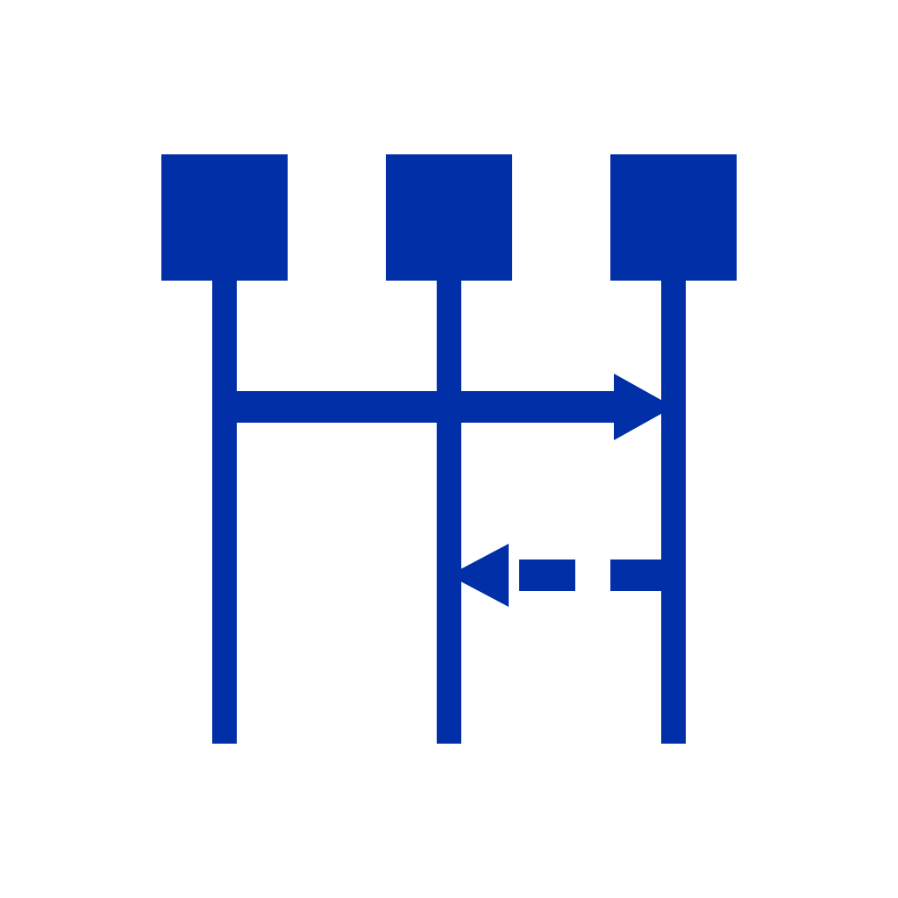
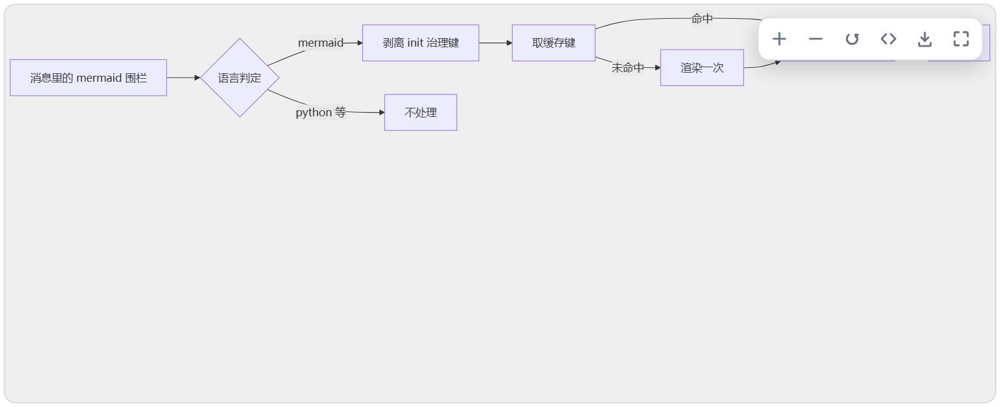
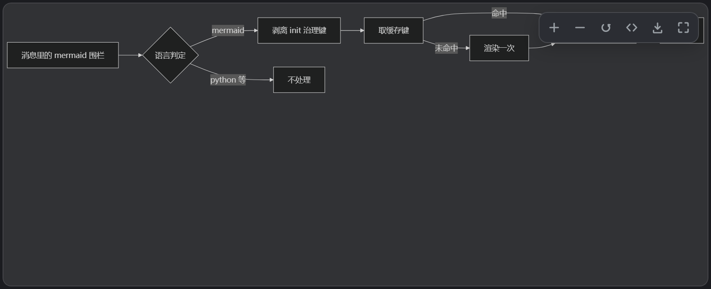
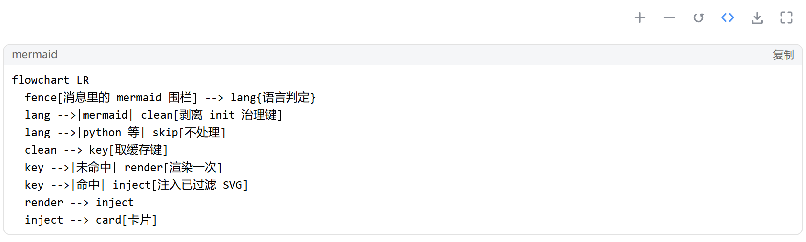
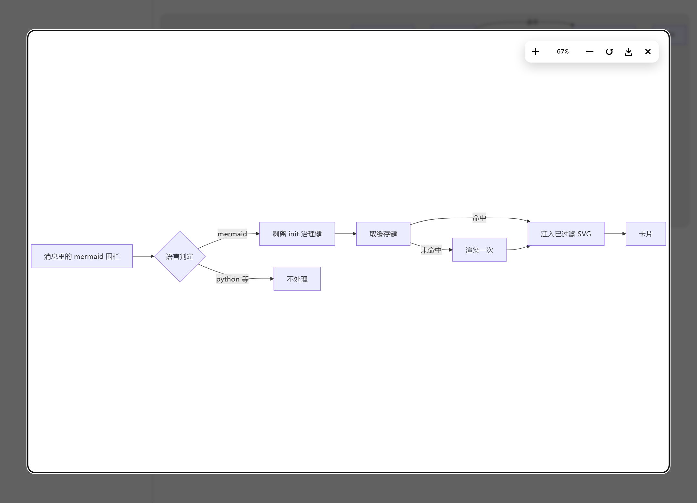

<picture>
  <source media="(prefers-color-scheme: dark)" srcset="assets/icons/icon-dark.svg">
  
</picture>

# dsh-mermaid-studio

DeepSeek Harness 插件：对话里的 mermaid 围栏直接渲染成图。图能缩放、能全屏、能导出 SVG，渲染结果留在本地，同一张图切回来不用重画。

[English](README.en.md) | 中文



## 功能

- **认围栏**：认 `mermaid` 和 `mmd`。宿主把围栏横幅标成通用的「代码块」，插件照样认得出；`python`、`ts` 这类带真实语言名的围栏不会被误判。
- **渲染**：mermaid 11.17.2 内联在插件里，不联网。渲染排队串行执行，单张 15 秒超时，连续两次超时就熔断，一张坏图不会拖住后面的图。
- **缓存**：内存加 IndexedDB 两级。命中直接注入，不闪；刷新、重启之后仍然命中。
- **交互**：Ctrl/⌘ + 滚轮以指针为锚点缩放，拖拽平移，双击在适应窗口与 1:1 之间切换。
- **控件**：没有常驻工具栏。鼠标移到图上，右上角浮出放大、缩小、重置、源码、导出、全屏六个按钮，移开就收起。
- **全屏**：CSS overlay，不占系统 F11。Esc 关闭，焦点回到原来的按钮，缩放百分比可以直接输入。
- **导出**：只导出 SVG，序列化的是过滤之后的那棵 SVG 树。
- **主题**：跟随 DSH 的深浅色，亮暗两套各自缓存。

## 效果预览

<table>
  <tr>
    <td align="center" width="50%"><br><sub>浅色：图直接成卡，鼠标移上去右上角浮出控件</sub></td>
    <td align="center" width="50%"><br><sub>暗色：跟随 DSH，亮暗两套各自缓存</sub></td>
  </tr>
  <tr>
    <td align="center"><br><sub>点 <code>&lt;/&gt;</code> 回到源码，控件行停在代码块上方</sub></td>
    <td align="center"><br><sub>全屏：缩放百分比可以直接输入</sub></td>
  </tr>
</table>

## 工作原理

插件是 Host + Client 两半的 bundle：Host 那半边只承载配置，界面和渲染都在浏览器侧。一份围栏走六步：

1. **认围栏**：扫描宿主渲染出的 `div.md-code-block`，语言判定看三条线索——横幅文字、`language-*` 类、严格的首行关键字。宿主的横幅对 mermaid 显示的是本地化通用标签，所以首行规则用来兜底。命中后把卡片插在代码块前面，代码块本身不动。
2. **剥离治理键**：`%%{init: …}%%` 和 frontmatter 里的 `securityLevel`、`htmlLabels`、`fontFamily`、`themeVariables` 会被拆掉，免得一张图改掉全局渲染配置；剥离时控件行会标出来。
3. **查缓存**：缓存键由源码、主题、字体、引擎版本和过滤规则版本算出。先查内存，再查 IndexedDB。
4. **渲染**：两级缓存都没命中才进队列。mermaid 需要 DOM，只能在主线程跑；队列串行是因为引擎的 `initialize()` 是全局配置，并发渲染会串色。
5. **过滤后注入**：渲出的 SVG 先解析成游离文档，按元素、属性白名单过滤，`<style>` 用 CSSOM 重建并加上 `#<renderId>` 前缀，最后 `importNode` 插入。缓存命中也走同一条出口，库里的字符串按不可信输入处理。
6. **卸载即清**：移除卡片和 `<style>`，断开两个 observer，删掉 IndexedDB 库，清掉本地键。

## 部署

需要 DSH `>= 0.2.1-rc.2`，桌面版与 Web 版都能用。

### 在 DSH 里输入包名安装

1. 打开 DSH 的「插件」页，点「添加插件」，选「安装第三方插件」。
2. 在「包名或地址」里填 `@hankai233/dsh-mermaid-studio`，点「安装」。
3. 按页面提示重启 DSH。

### 从源代码构建

仓库里带了构建产物 `lib/`，不改 `src/` 的话可以直接装；改过 `src/` 才需要重新构建。

```powershell
git clone https://github.com/Hankai233/dsh-mermaid-studio.git
cd dsh-mermaid-studio

# 可选：重新构建。npm install 会装上构建用的 mermaid@11.17.2
npm install
$env:DSH_PROFILE_DIR = "$env:USERPROFILE\.dsh\profiles\desktop"
npm run build
```

构建完在「插件」页点「添加插件」，填这个目录的绝对路径；用命令行则是 `dsh plugin add <目录绝对路径>`。

### 让 Agent 帮忙构建安装

把下面这段整段发给 DSH 里的 Agent：

```text
帮我在这台机器上安装 DSH 插件 @hankai233/dsh-mermaid-studio。

仓库：https://github.com/Hankai233/dsh-mermaid-studio

请按这个顺序做，每步结束确认结果再做下一步：
1. 选一个合适目录克隆仓库（不要放进 DSH 自己的安装目录）。
2. 检查 clone 下来的 lib/index.js 与 lib/client.js 是否存在且非空。
   缺失时设置 DSH_PROFILE_DIR 后运行 npm install && npm run build
   （需要 mermaid@11.17.2，版本不符会直接报错，别改成别的版本）。
3. 用插件页的「添加插件」填克隆目录的绝对路径安装，或者调用
   plugin_manager install_bundle，target 指到这个目录。
4. 如果 dsh-mermaid-smooth 还启用着，先停用它。
5. 按提示重启 DSH，在对话里发一条 mermaid 围栏，确认出现图表卡片、
   鼠标移上去右上角浮出放大/缩小/重置/源码/导出/全屏六个按钮。
6. 汇报：改了哪些文件的绝对路径、构建产物的 sha256、第 5 步实际看到的结果。

不要改插件源码；不要为了通过验证去关掉 DSH 的安全设置。
```

## 更新记录

每次改动都记在 [docs/CHANGELOG.md](docs/CHANGELOG.md)。

## 开源协议

本项目基于 GPL-3.0 发布，见 [LICENSE](LICENSE)。
