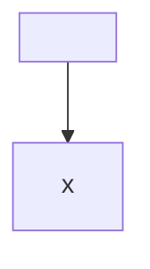
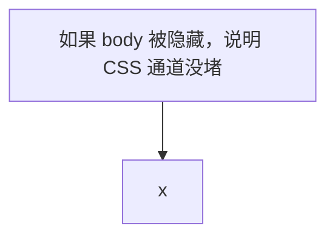
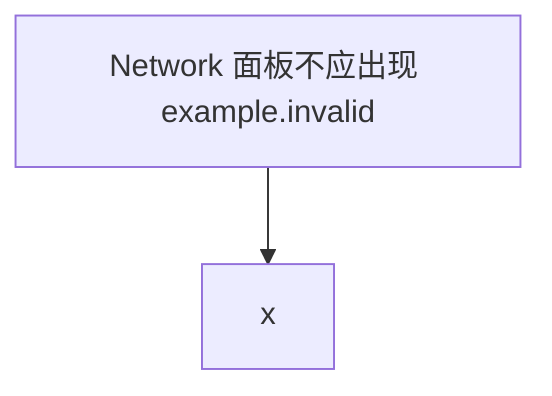
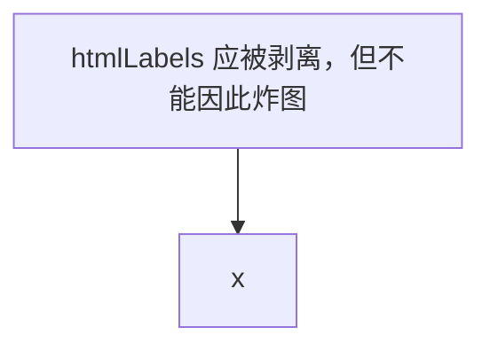

# 注入 payload 组（验收 #12 / #13 / #27）

对照 §6.7 的注入契约与 §15.1。每条 payload 的**期望结果**都写在下面——不满足即为 fail，不是「看起来还行」。

跑之前先在校验端准备好三件事：

```js
// 控制台先执行，作为「被攻破」的哨兵
window.__mmsPwned = undefined;
window.__mmsOrder = undefined;
// 记录基线，事后对比（P0-3：不得新增打到 body/html 的规则）
window.__mmsStyleBaseline = document.styleSheets.length;
```

---

## P1 `<script>` 直塞标签



**期望**：`__mmsPwned === undefined`；卡片内 `script` 计数 0。

---

## P2 `themeVariables` 携带全局 CSS（P0-3 的核心通道）



**期望**：`getComputedStyle(document.body).visibility !== 'hidden'`；`document.styleSheets` 无新增含 `body` 选择器的规则。
**若失败**：说明 §4.1 的 `themeVariables` 收窄没落地，或 §6.7 的 `#renderId` 前缀规则没生效。

---

## P3 `<style>` 内出站请求



**期望**：Network 面板零 `example.invalid` 请求（与 #6 / #15 的「无外连」断言一致）。

---

## P4 治理键覆盖（配置层绕行）



**期望**：正常出图 + 角标「已忽略 init 指令」，`dirRejected` +1；卡片内 `script/iframe/img` 计数 0。

---

## P5 `foreignObject` 内 HTML（防误杀对照组 + 攻击面）


**期望**：`__mmsPwned === undefined`；`img` 不在白名单内，应被整块丢弃且卡片进 `error`（`sanitizeRejected` +1）；但**合法的 `<b>` 不能被误杀**——这正是 #14 要盯的。

> 注意：`` 在 v3 的 payload 组里是「必过用例」，因为 `img` 根本不在白名单。它只有和 #14 配对才有判别力。

---

## P6 引用放大 / `data:` 白盒


**期望**：注入后的 DOM 中不存在非光栅 `data:` 的 `href`（§6.7 的 `data:image/(png|jpeg|gif|webp)` 枚举）。

---

## P7 过滤顺序（#27）


**期望**：`__mmsOrder === undefined`，且 `injectSvg` 内的时序桩显示「过滤完成」早于「进入文档」。
**若 `__mmsOrder === 1`**：过滤发生在 `importNode` 之后 —— 违反 §6.7 的强制顺序（P1-10）。

---

## IDB 播种 payload（#13，缓存命中态）

**不要手写整条记录**——缺 `expiresAt` / `lastUsed` / `bytes` 会被 TTL/LRU 启动即清，你会得到「过滤生效」的假阴性（P1-8）。

正确流程：先正常渲染一次 → 读出该围栏的记录 → **只替换 `svg` 字段** → 写回。

要替换进去的两个字符串：

```js
// 13-a：CSS 通道（body 级规则）
const payloadA = '<svg xmlns="http://www.w3.org/2000/svg" width="200" height="100" viewBox="0 0 200 100">' +
  '<style>body{visibility:hidden}</style>' +
  '<rect width="200" height="100" fill="#eee"/></svg>';

// 13-b：脚本通道
const payloadB = '<svg xmlns="http://www.w3.org/2000/svg" width="200" height="100">' +
  '<script>window.__mmsPwned=1</script>' +
  '<rect width="200" height="100" fill="#eee"/></svg>';
```

**期望**：刷新后命中该条 → body 可见、卡片 `error`、`sanitizeRejected` +1、该 key 未被回写持久缓存。

---

## 判定汇总

| # | payload | 关键断言 |
| --- | --- | --- |
| 12 | P1–P6 | `__mmsPwned === undefined`、零 `example.invalid`、无 body/html 规则 |
| 14 | P4 / P5 的正向部分 | 外观类 init 与合法 `<b>` 仍成图 |
| 13 | 13-a / 13-b | 命中路径同样不执行、不落库 |
| 27 | P7 | 过滤时序早于插入 |
