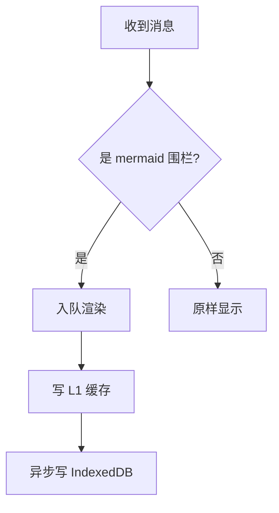
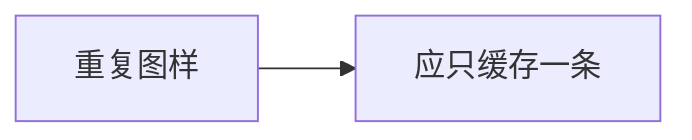
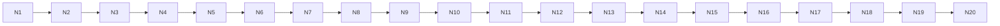
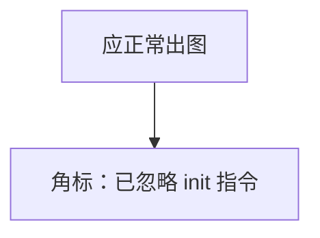
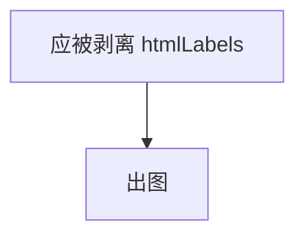
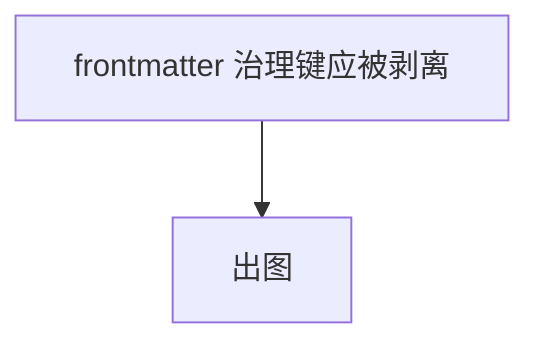
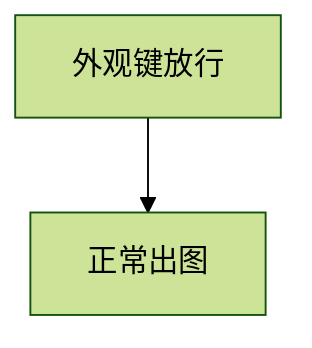

# 边界与异常图样（验收用）

用法：把整段内容发给 DSH（或粘进一个新会话），逐条对照 §15 / §15.1 的用例。**每条前面的编号就是它服务的用例。**

---

## A. 正常路径（#1 / #3 / #8）

### A1 普通流程图



### A2 同一源码出现 5 次（Bd11：渲染 ID 不冲突、缓存 1 条 hits=5）




### A3 超宽图（#4 #4③：fit 允许 s < 0.1，首次用户输入钳回）



---

## B. 不该被渲染的场景（#25 作用域 / #4.2）

### B1 python 围栏（对照组：必须零改动、零 error 卡）

```python
def render(source):
    """这里不该出现 mermaid 卡片"""
    return source.strip()
```

### B2 空围栏（Bd1）

```mermaid
```

### B3 只有指令没有图（Bd1）

```mermaid
%%{init: {"theme": "dark"}}%%
```

---

## C. 治理键剥离（#22 / P1-9）

### C1 `securityLevel: loose`



### C2 嵌套在容器键里的治理子键



### C3 YAML frontmatter 的 config 块（优先级高于 initialize）



### C4 外观类 init（#14 防误杀：必须正常成图）



---

## D. 失败路径（#9）

### D1 语法错误

```mermaid
graph TD
  A[ --> ]]]
```

### D2 未知图形类型

```mermaid
notARealDiagram
  A --> B
```

---

## E. 超长（#22 / 超限闸门）

请用生成器产出，不要手写：

```bash
node qa/fixtures/gen-large.mjs
# 产出：20-diagrams.md / oversize.md / same-source.md
```

`oversize.md` 里的围栏归一化后 > 50,000 字符，期望：**直接 error「源码过长，已跳过渲染」，不进队列，不显示「重试」**。

---

## F. 会话语义（#3 / #25 / #26）

1. 在**会话 A** 发一张 A1 的图。
2. 新建**会话 B**，再发同一张图。
3. 切回会话 A：`renderCount` 不增、`cacheHitCount` 增（L1 命中）。
4. 删除会话 B，重启：B 的 `scopeHash` 条目为 0，A 的条目仍在。
5. 在**侧栏文件预览**里打开本文件：不应出现任何 `.mms-card`，IDB 也不应新增记录。
